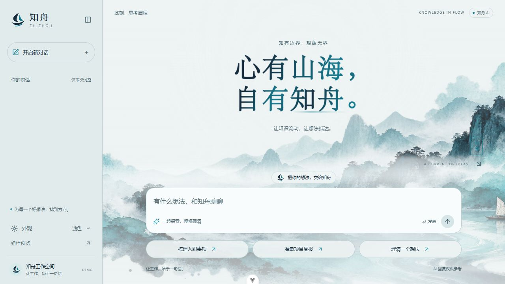
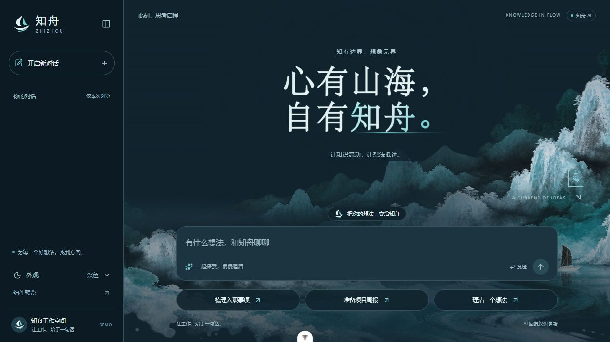
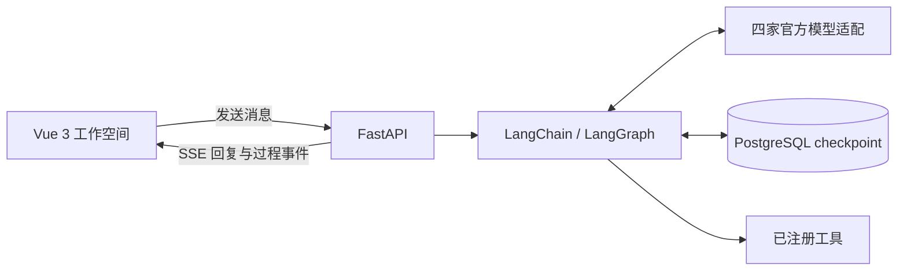

<p align="center">
  
</p>

<h1 align="center">知舟 · Zhizhou</h1>

<p align="center"><strong>心有山海，自有知舟。</strong></p>
<p align="center">让知识流动，让想法抵达。<br />一个面向日常工作的开源 AI 工作空间。</p>

<p align="center">
  <a href="frontend/package.json"></a>
  <a href="backend/pyproject.toml"></a>
  <a href="backend/README.md#启动与聊天接口"></a>
  <a href="LICENSE"></a>
</p>

<p align="center">
  <a href="#为什么做知舟">项目愿景</a> ·
  <a href="#现在可以体验什么">功能亮点</a> ·
  <a href="#开发进度">开发进度</a> ·
  <a href="#本地体验">本地体验</a> ·
  <a href="#开发与参与">开发文档</a>
</p>

<picture>
  <source media="(prefers-color-scheme: dark)" srcset="docs/images/home-dark.jpg" />
  <source media="(prefers-color-scheme: light)" srcset="docs/images/home-light.jpg" />
  
</picture>

<p align="center"><sub>项目实际界面 · 青蓝水墨与明暗主题 · 封面随你的 GitHub 明暗主题自动切换</sub></p>

> **正在构建中。** 已有注册登录、流式对话与工具过程展示，前端已对接服务端会话目录、历史读取、续聊、标题同步与改名和软删除，刷新后可从侧栏重新打开历史。用户、部门与范围权限管理已完成前后端对接，超管和部门管理员按范围管理组织与成员。组件预览仍可独立运行。文件工作区、企业知识库和分享仍在规划中。

## 为什么做知舟

工作中的一个问题，往往散落在文档、文件和同事的经验里。找到资料只是开始，把资料变成清晰的结论和可执行的下一步，才是我们真正想完成的事。

知舟希望把这些工作放进一个对话空间：**用自然语言说明目标，让智能体查找知识、处理文件，并在需要时请你确认下一步。** 面向企业内部非技术人员，员工通过浏览器使用，工作环境由服务器承载。

我们正在从一个能对话、能展示执行过程的工作空间出发，逐步走向以下场景：

| 你的一句话 | 希望知舟帮你完成的事 |
| --- | --- |
| “帮我整理一份新员工入职清单。” | 当前可以通过模型对话起草内容；未来结合企业制度生成清单。 |
| “把这几份材料整理成项目周报。” | 规划接入文件工作区，阅读材料、提炼进展与风险并生成文档。 |
| “公司差旅报销有哪些要求？给我出处。” | 规划接入企业知识库，通过 RAG 检索资料并提供来源。 |
| “这项操作先让我确认，再继续。” | 规划加入人工审批，让需要确认的动作暂停并在审批后恢复。 |

## 现在可以体验什么

### 一边生成，一边看见结果

对话通过 SSE 实时输出，无需等待整段回答生成后才看到内容。助手回复支持 Markdown、表格、代码高亮和复制；异常中断时保留已经收到的内容，方便继续查看。

### 从回答到过程，都有迹可循

助手在工具调用时用正文说明当前行动、方法和公开依据，首次调用还会介绍本轮执行规划，随后显示工具请求、执行状态与公开结果；需要继续操作时，再显示下一步说明。无需工具时直接完成回答。最终回答完成后，之前的过程自动折叠，可展开查看全部行动说明、调用参数及返回结果。详细说明由提示词引导，模型遗漏正文时仅补充中性工具提示；模型内部推理不对外展示。

天气工具当前返回固定演示内容，命令展示协议已接入，但尚未提供真正的 Shell 执行器。

### 给想法一个安静的起点

青蓝水墨、山海与小舟构成首页，搭配明暗主题、轻量动效和响应式布局。桌面侧栏支持收起，窄屏使用抽屉导航；系统开启减少动态效果时，首页会相应减少动效。

<details>
<summary>查看深色首页</summary>



</details>

### 已有可以继续扩展的对话基础

后端通过异步 SQLAlchemy ORM 保存用户、业务会话和公开问答历史，使用 JWT 校验身份；后端生成的 `conversation_id` 用于读取与继续自己的会话。目录和内容按游标读取最近及更早记录，支持软删除；LangGraph checkpoint 独立保存模型上下文。同会话的聊天、模型切换和删除竞争执行锁，不同会话可并发；后端已支持 AI 自动标题及生成中手动改名，手动标题优先。前端已接入认证、账号会话目录、历史与公开过程恢复、续聊和删除，回答完成后同步自动标题，侧栏支持弹窗改名。状态说明与交互边界见[前端文档](frontend/README.md#页面与聊天边界)，标题与接口说明见[后端文档](backend/README.md#自动标题与手动改名)。

## 开发进度

| 能力 | 状态 | 当前范围 |
| --- | --- | --- |
| 模型配置 | 前后端已接通 | 模型管理页通过品牌卡片与居中弹窗配置连接，以开关启用内置目录模型并手动设置全局默认；百炼直接粘贴 Base URL，支持主动测试与版本冲突提示。 |
| 受限模型自选 | 前后端已接通 | 连接/模型独立启停，固定或受限自选推理；聊天按会话保存具体选择，失效与版本冲突保留草稿并引导重选；见[前端文档](frontend/README.md#模型管理)。 |
| Web 流式对话 | 已实现 | Bearer 认证聊天，首轮取得服务端 ID，之后按同一 ID 续聊。 |
| 行动说明与执行过程 | 已实现 | 正文与工具交错展示，完成后整体折叠，可展开查看全部过程；不展示内部推理。 |
| Markdown 与主题 | 已实现 | 富文本、代码高亮与复制，明暗主题及窄屏适配。 |
| 对话状态保存 | 前后端已接通 | 账号目录和公开历史按游标读取、用户隔离及软删除；模型 checkpoint 独立保存。 |
| 会话标题 | 前后端已接通 | 首问先形成临时标题，成功回答后由 AI 概括并同步侧栏与页头，失败后续重试；侧栏支持生成中弹窗改名，手动标题优先。 |
| 停止与恢复 | 部分实现 | 连接断开可取消生成；停止按钮、持久化任务与断线续传待实现。 |
| 人工审批 | 规划中 | 审阅待执行动作、批准或拒绝，并恢复执行。 |
| 文件工作区 | 规划中 | 在服务器工作环境中读取、创建和修改文件。 |
| 企业知识库 | 规划中 | 共享资料检索、RAG 问答与来源引用。 |
| 用户与权限 | 前后端已接通 | 按操作与范围控制管理入口；部门与成员管理、账号筛选与启停改密、管理员任免及撤权回退；个人会话隔离，见[组织与权限管理](frontend/README.md#组织与权限管理)。 |
| 完整容器化部署 | 规划中 | 当前开发 Compose 仅包含 PostgreSQL。 |

## 本地体验

**先看界面**：准备符合要求的 Node.js 与 pnpm，在仓库根目录执行：

```shell
cd frontend
pnpm install --frozen-lockfile
pnpm dev
```

打开终端提示的地址进入登录页；启动后端后即可注册登录、聊天、查看历史和管理自己的会话。开发模式下可独立访问 `/dev/ui` 查看明暗主题、响应式布局、富文本与过程卡片样例；组件预览不需要登录、模型密钥或数据库。

**体验真实对话**：按以下顺序准备后端，再使用前端页面或支持 POST SSE 的 HTTP 客户端调用：

1. 准备 Python **3.14+**、uv、Docker Compose 与所选官方供应商的 API 密钥；前端 Node.js 要求为 `^22.18.0 || >=24.12.0`，使用 pnpm。
2. 按[后端配置说明](backend/README.md#配置与数据库)准备配置加密主密钥及 JWT 密钥、启动 PostgreSQL 并执行 Alembic 迁移；已有 `.env` 时直接编辑，不覆盖现有配置。
3. 按[后端启动说明](backend/README.md#启动与聊天接口)启动服务，注册账号并按[权限运维说明](backend/docs/authorization-api.md#错误并发和运维)授予首次超管身份。以超管登录[模型管理](frontend/README.md#模型管理)，配置连接、开启模型并设置默认，普通用户即可聊天；也可通过 Swagger 验收。

后端默认测试包含真实 PostgreSQL，使用同一实例中自动创建与销毁的独立临时库，无需真实模型密钥；运行方式见[后端测试说明](backend/README.md#测试)。

详细安装、配置、测试与构建命令分别维护在[前端文档](frontend/README.md)和[后端文档](backend/README.md)。完整生产部署尚未提供，生产反向代理需要关闭 SSE 缓冲。

## 技术方案

| 层次 | 技术与职责 |
| --- | --- |
| 前端 | Vue 3 · TypeScript · Vite · Pinia · Reka UI |
| 内容呈现 | markdown-it · highlight.js · Lucide Vue |
| API 与传输 | Python · FastAPI · 异步 POST SSE |
| 智能体 | LangChain / LangGraph · OpenAI、Anthropic、DeepSeek、阿里云百炼 |
| 状态存储 | PostgreSQL · SQLAlchemy 异步 ORM · Alembic · AsyncPostgresSaver |
| 开发工具 | pnpm · uv · Vitest · pytest · Docker Compose（数据库） |



## 开发与参与

如果你也关注 AI 工作空间、企业知识管理或智能体交互，欢迎通过 [Issues](https://github.com/wkdabl0304-ship-it/zhizhou/issues) 交流使用场景、反馈问题，或提交 Pull Request。

| 从哪里开始 | 阅读内容 |
| --- | --- |
| [前端开发说明](frontend/README.md) | 环境、界面与聊天边界、组件约定、构建和测试。 |
| [后端开发说明](backend/README.md) | 配置、启动、SSE 协议、Agent、日志和测试。 |
| [模型选择与管理](frontend/README.md#模型管理) | 模型管理界面、会话选择及前端恢复规则；接口详见后端模块文档。 |
| [组织与权限管理](frontend/README.md#组织与权限管理) | 部门、成员、账号操作及前端授权恢复规则；[接口契约](backend/docs/authorization-api.md)。 |
| [项目协作约定](AGENTS.md) | 技术版本、代码注释、变更讲解和文档维护规则。 |

## 许可证

本项目采用 [Apache License 2.0](LICENSE)。
