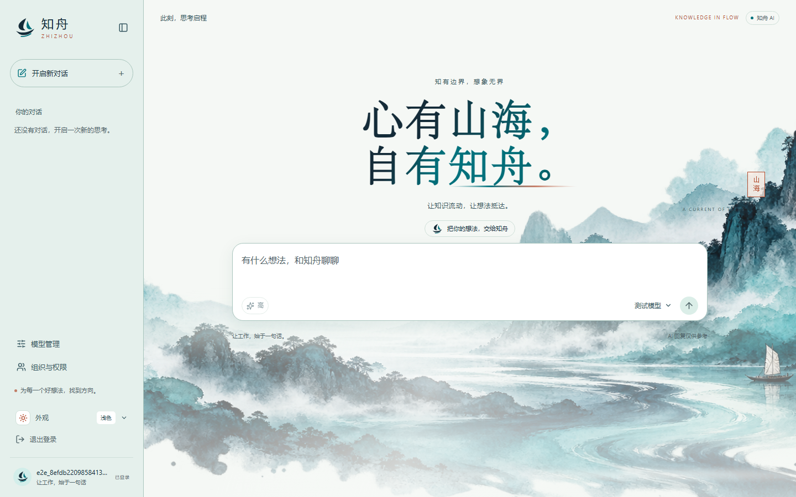
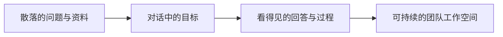
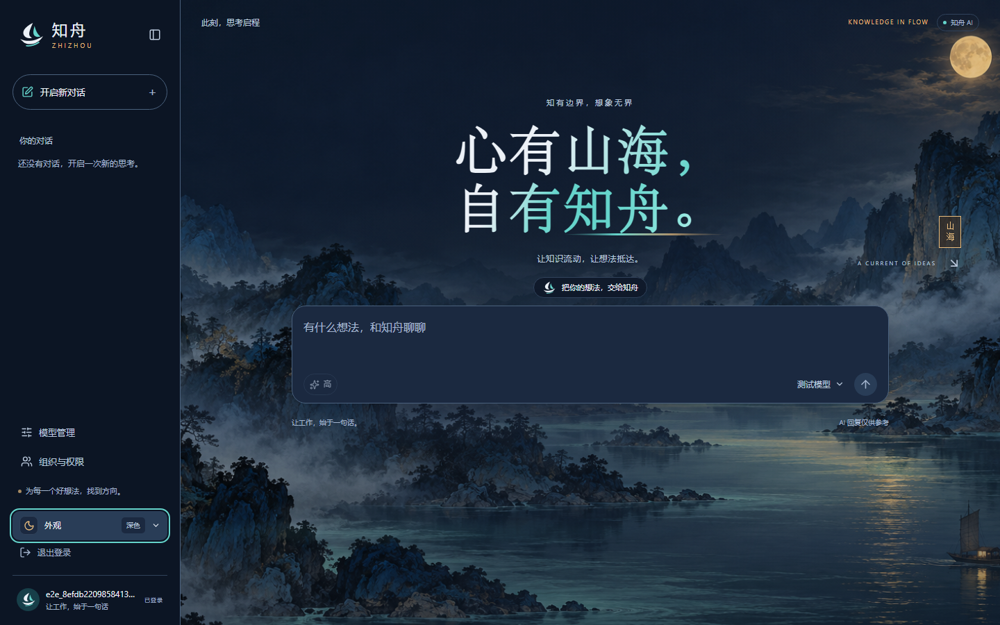
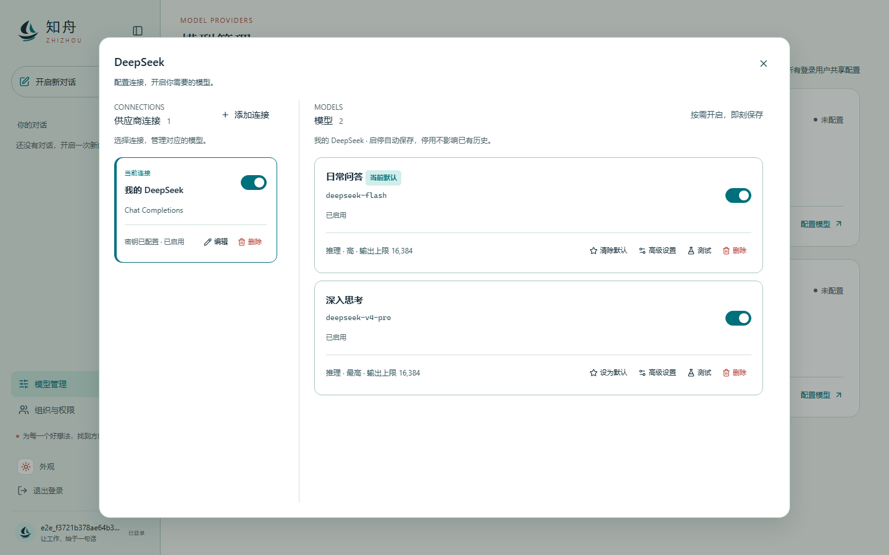
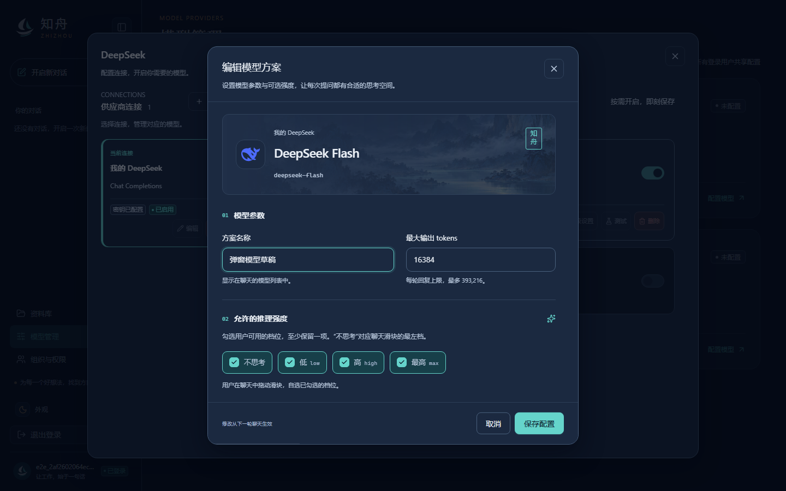
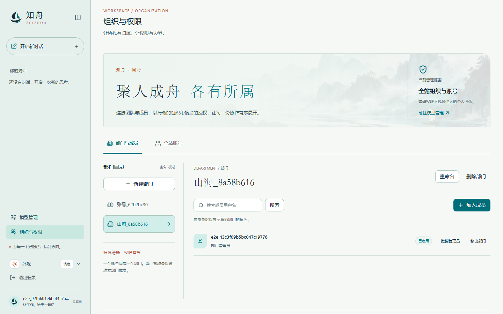
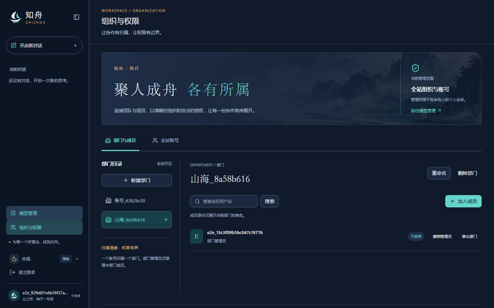
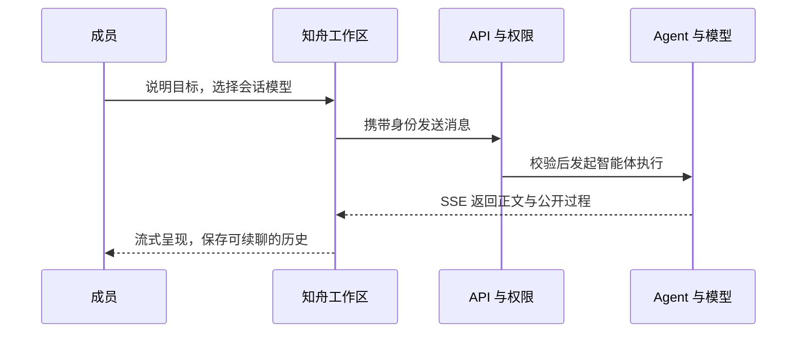
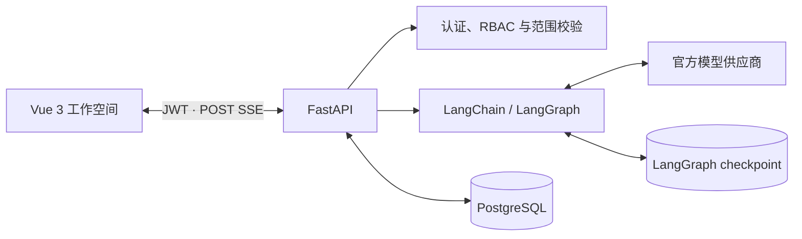

<p align="center">
  
</p>

<h1 align="center">知舟 · Zhizhou</h1>

<p align="center"><strong>心有山海，自有知舟。</strong></p>
<p align="center">让知识流动，让想法抵达。</p>
<p align="center">面向企业员工的 AI 工作助手：直接对话，自动查阅有权限的内部资料，给出附带出处的回答，并逐步支持文件生成与修改。</p>
<p align="center"><sub>An open-source AI workspace for conversations, model governance, and scoped organization access.</sub></p>

<p align="center">
  <a href="frontend/package.json"></a>
  <a href="backend/pyproject.toml"></a>
  
  <a href="LICENSE"></a>
</p>

<p align="center">
  <a href="#知舟从哪里来">项目来历</a> ·
  <a href="#它能带来什么">核心能力</a> ·
  <a href="#一眼看见知舟">界面一览</a> ·
  <a href="#开始体验">快速开始</a> ·
  <a href="#参与开发">参与开发</a>
</p>

<picture>
  <source media="(prefers-color-scheme: dark)" srcset="docs/images/workspace-dark.png" />
  <source media="(prefers-color-scheme: light)" srcset="docs/images/workspace-light.png" />
  
</picture>

<p align="center"><sub>真实工作区 · GitHub 会随阅读者的明暗主题自动切换封面</sub></p>

## 知舟从哪里来

知舟起于一个很朴素、却反复出现的工作场景：一个问题的答案分散在资料、文件和同事的经验里。找到片段只是开始，真正困难的是把它们组织成一段可靠的判断，再推进成下一步行动。

因此，我们没有把它当成“再做一个聊天框”。知舟先从 DeepSeek 智能体试验和静态对话原型出发，逐步补上让它能够进入团队日常工作的基础：流式交付、可见的执行过程、持久会话、身份隔离、多供应商模型配置，以及组织范围内的权限管理。

它的名字也来自这个愿望：当信息像山海一样庞杂时，给每个想法一只可以靠岸、可以继续出发的舟。



知舟当前是一个可本地部署、可继续开发的 MVP。它已经把对话、模型、组织管理与资料库连成可用路径：全局、部门、个人空间支持目录管理、上传下载、重命名、递归删除和上传上限配置，资料库界面适配桌面、窄屏和明暗主题。企业知识库、人工审批和完整生产容器化仍在规划中。

### 接下来要实现的体验

员工上传文件时，可以选择仅用于当前会话，或保存到有写入权限的全局、部门、个人文件空间及目录。空间文件自动建立检索索引；聊天时，智能体在授权范围内查找资料、按需阅读原文，并给出结论及源文件出处。无法解析的文件仍保留查找和打开入口，后续逐步支持在个人空间生成文件及修改授权文件。

文件管理是用户入口，RAG 是后台能力：用户管理完整原文件，无需配置切分或维护另一套知识库。当前已实现独立资料库及原文件管理接口，尚未实现上述聊天上传与检索流程；界面使用见[前端资料库](frontend/README.md#资料库)，接口见[共享文件说明](backend/docs/files-api.md)，整体方向见[产品定位与功能蓝图](docs/product-positioning.md)。

## 它能带来什么

| 对谁有用   | 在知舟里可以做什么                                                                                              |
| ---------- | --------------------------------------------------------------------------------------------------------------- |
| 使用者     | 发起流式对话，查看 Markdown、代码和表格；续聊历史会话；保留自动标题或手动改名；在允许范围内选择模型与推理档位。 |
| 管理者     | 通过界面配置 OpenAI、Anthropic、DeepSeek、阿里云百炼连接，独立启停模型、测试连接、设置默认与允许的推理强度（含不思考）；用户在聊天滑块中自选。      |
| 组织管理员 | 管理部门、成员与管理员任免；筛选账号、启停账号和改密；权限按全局、部门和本人范围落实到服务端。                  |
| 开发者     | 以 Vue 3、FastAPI、PostgreSQL 和 LangGraph 为基础继续扩展；现有分层测试、迁移和接口契约可作为新能力的起点。     |

### 不只回答，也让过程可见

知舟通过 SSE 逐段交付回复，不必等整段答案完成。助手回答支持 Markdown、表格、代码高亮与复制；连接异常时会保留已经收到的内容。

当模型调用工具时，界面呈现公开的行动说明、工具调用、参数和结果。任务完成后，过程会收起为可展开的时间线，让阅读保持清爽，也让必要的依据随时可追溯。模型内部推理不会被展示。

### 不把模型管理留在环境变量里

模型连接、模型启停、默认模型、推理档位和连接测试都在工作区内完成。聊天的模型选择会随会话保存；当配置在别处变化时，界面保留草稿并引导用户重新确认，而不是悄悄覆盖选择。

### 不把权限当成一个前端开关

前端会依据服务端签发的 `grants` 显示入口和操作，但安全边界在后端：每次管理请求都会再次校验权限与资源范围。普通成员不能通过构造请求进入管理操作，部门管理员不能越过自己被授权的部门；停用、改密或撤权后，旧令牌和已打开的管理页面会被同步收回。

## 一眼看见知舟

### 为思考留白，为夜晚保留沉静

<table>
  <tr>
    <td width="50%" valign="top">
      
      <strong>青碧 · 朱砂</strong><br />
      暖白纸面、青蓝水墨与充足留白，让对话成为进入工作的安静起点。
    </td>
    <td width="50%" valign="top">
      
      <strong>靛夜 · 月金</strong><br />
      不是简单反色。深色主题拥有独立的月夜山海、层级和操作色。
    </td>
  </tr>
</table>

### 让模型治理和组织边界成为产品的一部分

<table>
  <tr>
    <td width="50%" valign="top">
      
      <strong>模型配置</strong><br />
      在同一处管理供应商连接、模型可用性和全局默认项。
    </td>
    <td width="50%" valign="top">
      
      <strong>模型方案</strong><br />
      集中编辑名称与输出上限，超管勾选可用强度（含不思考），用户在聊天中拖动自选。
    </td>
  </tr>
  <tr>
    <td width="50%" valign="top">
      
      <strong>组织与权限</strong><br />
      部门、成员、角色与账号状态都有明确的管理入口。
    </td>
    <td width="50%" valign="top">
      
      <strong>范围清晰</strong><br />
      超级管理员管理全局；部门管理员只看见并管理自己的范围。
    </td>
  </tr>
</table>

所有截图来自当前浏览器端到端验收，使用测试账号与测试数据；它们展示的是已实现的界面，不是概念稿。

## 从一次提问到一次协作



在这条链路里，会话和历史按账号隔离；模型选择和标题随会话保存；模型配置与组织权限由服务端控制。它为之后接入企业资料、文件处理与审批流程预留了清晰的边界。

## 开始体验

### 先看界面

准备 Node.js `^22.18.0 || >=24.12.0` 与 pnpm：

```shell
git clone https://github.com/wkdabl0304-ship-it/zhizhou.git
cd zhizhou/frontend
pnpm install --frozen-lockfile
pnpm dev
```

打开终端输出的地址即可进入登录页；开发模式也提供无需登录的组件预览页 `/dev/ui`。

### 启动完整工作区

完整功能需要 Python 3.14+、uv、Docker Compose 与至少一个模型供应商的 API 密钥。请按[后端启动与配置说明](backend/README.md#配置与数据库)准备 PostgreSQL、密钥和 Alembic 迁移，再启动服务。

首次注册的账号是普通成员。根据[权限运维说明](backend/docs/authorization-api.md#错误并发和运维)授予一个账号超级管理员权限后，即可在“模型管理”创建连接、启用模型并设置默认。前端开发服务器会将 `/api` 代理到 `http://127.0.0.1:8000`。

生产部署时，请将 `/api` 转发到后端并关闭 SSE 响应缓冲。当前 Compose 用于本地 PostgreSQL 开发环境；完整容器化部署仍在规划中。

## 技术底座



| 层次   | 技术与职责                                                                              |
| ------ | --------------------------------------------------------------------------------------- |
| 前端   | Vue 3、TypeScript、Vite、Pinia、Vue Router、Reka UI；明暗主题、响应式工作区与组件预览。 |
| 后端   | FastAPI、异步 SQLAlchemy、Alembic、PostgreSQL；认证、范围权限、会话与模型配置 API。     |
| 智能体 | LangChain / LangGraph；适配 OpenAI、Anthropic、DeepSeek、阿里云百炼。                   |
| 质量   | Vitest、Playwright、pytest；浏览器 E2E 连接真实后端，并使用独立临时数据库。             |

## 项目结构

```text
zhizhou/
├── frontend/          # 工作区界面、共享组件与浏览器测试
├── backend/           # API、鉴权、会话、模型配置与数据库迁移
├── docs/product-positioning.md # 产品定位、文件与检索规则及待决事项
├── docs/images/       # README 使用的真实产品截图
├── AGENTS.md          # 协作、测试与文档约定
└── README.md          # 这个项目的起点
```

## 质量与验证

前端和后端都有行为、集成与端到端测试。提交前可运行：

```shell
# 在 frontend/ 中执行
pnpm verify

# 在 backend/ 中执行
uv run pytest -q
```

前端验证包含类型检查、只读 lint、Vitest 覆盖率和真实后端 E2E。后端测试会自动创建并清理独立 PostgreSQL 临时库，不需要真实模型密钥。

## 参与开发

如果你也在思考 AI 如何从“会回答”走向“能协作”，欢迎带着场景、问题或改进参与进来。

| 你想做什么               | 从这里开始                                            |
| ------------------------ | ----------------------------------------------------- |
| 理解产品方向与文件知识库规划 | [产品定位与功能蓝图](docs/product-positioning.md)   |
| 开发界面或理解交互       | [前端开发说明](frontend/README.md)                    |
| 启动 API、数据库与 SSE   | [后端开发说明](backend/README.md)                     |
| 理解用户、部门和范围授权 | [组织权限接口契约](backend/docs/authorization-api.md) |
| 了解模型选择与管理       | [前端模型管理说明](frontend/README.md#模型管理)       |
| 遵循协作与验证要求       | [项目约定](AGENTS.md)                                 |

可以通过 [Issues](https://github.com/wkdabl0304-ship-it/zhizhou/issues) 讨论想法、反馈问题，或提交 Pull Request。

## 许可证

本项目采用 [Apache License 2.0](LICENSE)。
